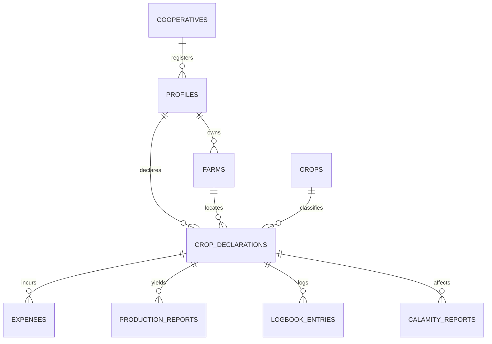

# AgriSense: Objective-by-Objective Implementation & Compliance Matrix

This document benchmarks the mobile portal implementation (`agreesensee_dart`) against the core research objectives, the consultation notes, and the web admin portal (`Agreesense`).

---

## 1. Executive Summary

| Objective / Feature | Status | Mobile Architectural Component | Web Portal Integration |
| :--- | :--- | :--- | :--- |
| **Objective 1: Recommendation & Saturation** | **Implemented** | `suitability_engine.dart`, `saturation_engine.dart`, `recommendation_engine.dart`, `crop_calendar_engine.dart` | Shares `crop_declarations`, `crops`, and `demand_baselines` |
| **Objective 2: Financial Modeling & P&L** | **Implemented** | `financial_engine.dart`, `expense_sheet.dart`, `production_report_sheet.dart` | Shares `expenses`, `production_reports`, and `market_prices` |
| **Objective 3: Supply Chain & Harvest Sync** | **Implemented** | `harvest_sync_engine.dart`, `supply_projection_screen.dart`, `surplus_screen.dart` | Corresponds to `supply_chain_screen.dart` |
| **Objective 4: Digital Logbook & Incidents** | **Implemented** | `logbook_form_screen.dart`, `calamity_form_screen.dart`, `records_screen.dart` | Feeds into `calamities_screen.dart` and `logbook_screen.dart` |
| **Objective 5: ISO/IEC 25010 Quality Standards** | **Evaluated** | Automated test suite (49/49 passing), zero lint issues, responsive layout | Robust UI architecture with offline fallback |

---

## 2. Objective-by-Objective Breakdown

### Objective 1: Recommendation Module, Land Suitability, Seasonal Constraints, Crop Saturation & Harvest Timelines
> *"To develop a recommendation module that analyzes land suitability, seasonal constraints, and crop saturation to recommend optimal planting strategies, including single-crop and intercropping (mix-and-match) scenarios—while generating automated harvest timelines to mitigate the risk of local oversupply."*

#### 1.1 Land Suitability
* **Implementation:** `lib/core/logic/suitability_engine.dart`
* **Mechanism:** 
  * Scores suitability per barangay using calibrated local datasets and soil affinities.
  * Banded into four categorical levels: `Very Suitable`, `Suitable`, `Moderate`, and `Marginal`.
  * Prevents recommending crops ill-suited to local soil/terrain conditions.

#### 1.2 Seasonal Constraints & Saturation Index
* **Implementation:** `lib/core/logic/saturation_engine.dart` & `recommendation_engine.dart`
* **Mechanism:**
  * Compares forward projected supply (active standing declarations) against market demand over a rolling 90-day cropping horizon:
    $$\text{Saturation Index} = \frac{\text{Expected Supply (Tons)}}{\text{Market Demand (Tons)}}$$
  * Categorized into:
    * 🟢 **Low Risk (<0.85 / <85%):** Room for expansion.
    * 🟠 **Moderate Risk (0.85–1.15 / 85–115%):** Supply and demand near balance.
    * 🔴 **High Risk (>1.15 / >115%):** Impending local oversupply / market glut.

#### 1.3 Intercropping (Mix-and-Match)
* **Implementation:** `RecommendationEngine.intercrops()` in `recommendation_engine.dart`
* **Mechanism:** Generates ranked multi-crop companion pairings (e.g., Eggplant + Legumes) with composite viability scores to promote crop diversification.

#### 1.4 Automated Harvest Timelines
* **Implementation:** `lib/core/logic/crop_calendar_engine.dart`
* **Mechanism:** Automatically expands planting dates into calendar stages (Nursery, Vegetative, Reproductive, Maturity, Harvest) and schedules agronomic tasks (fertilizer, irrigation, spraying) to provide an automated forward-looking harvest timeline.

#### 1.5 Login Screen Market Saturation Display *(New Feature)*
* **Implementation:** `_LoginSaturatedCropsTicker` in `lib/features/auth/login_screen.dart`
* **Mechanism:**
  * Displays an interactive, collapsible bar chart and percentage breakdown on the login screen.
  * Allows farmers to review oversupplied crops **before authenticating or committing to a crop declaration**.
  * Responsive layout preventing UI overflows on mobile viewports.

---

### Objective 2: Financial Modeling Tool, P&L, and Actual Cost Tracking
> *"To implement a financial modeling tool that recording profit margins based on projected market prices and land area, allowing farmers to compare the economic viability of recommended crops versus saturated crops (Risk Assessment), while tracking actual input costs (fertilizers, labor) to calculate final Profit and Loss (P&L) post-harvest."*

#### 2.1 Projected Margins & Viability Comparison
* **Implementation:** `lib/core/logic/financial_engine.dart` & `scenario_engine.dart`
* **Mechanism:**
  * Projects revenues using land area ($\text{ha}$) and historical/weekly farmgate market prices from `market_prices`.
  * Simulates three risk scenarios:
    * **Best Case:** $+15\%$ price, $+10\%$ yield.
    * **Expected Case:** Baseline yield and price.
    * **Worst Case:** $-20\%$ price, $-15\%$ yield.

#### 2.2 Input Cost Tracking
* **Implementation:** `lib/features/farmer/expense_sheet.dart` & `lib/models/expense.dart`
* **Mechanism:** Tracks actual farming expenses categorized by `seed`, `fertilizer`, `labor`, `irrigation`, `transport`, `pesticide`, and `equipment`. Expense records are linked directly to corresponding activities in the digital logbook.

#### 2.3 Post-Harvest P&L Calculation
* **Implementation:** `lib/features/farmer/production_report_sheet.dart`
* **Mechanism:**
  * Post-harvest reporting captures actual yield ($\text{kg}$), selling price ($\text{₱/kg}$), and losses/rejects.
  * Realized P&L is calculated automatically:
    $$\text{Net Margin} = (\text{Actual Yield} \times \text{Actual Price}) - \text{Total Recorded Expenses}$$

---

### Objective 3: Supply Chain Dashboard & Harvest Synchronization
> *"To engineer a supply chain dashboard that provides the MAO and Associations with a forward-looking supply projection, utilizing harvest synchronization logic to prevent simultaneous dumping of produce and automatically identifying alternative market channels or Association buy-back programs for predicted surpluses."*

#### 3.1 Forward-Looking Supply Projection
* **Implementation:** `lib/features/cooperative/supply_projection_screen.dart`
* **Mechanism:** Aggregates standing declarations by month and barangay to project total harvest volume and farmer counts.

#### 3.2 Harvest Synchronization Logic
* **Implementation:** `lib/core/logic/harvest_sync_engine.dart` & `pre_declaration_risk_panel.dart`
* **Mechanism:**
  * Identifies simultaneous harvest clusters within 14-day intervals across neighboring farmers.
  * Surfaces pre-declaration risk warnings to advise farmers to stagger planting dates or choose alternative crops.

#### 3.3 Surplus Channels & Buy-Back Programs
* **Implementation:** `lib/features/cooperative/surplus_screen.dart` & `market_channel_sheet.dart`
* **Mechanism:** Automatically maps projected surplus tonnages to alternative buyers (institutional buyers, food processors, or association buy-back programs).

---

### Objective 4: Digital Logbook & Incident / Calamity Reporting
> *"To establish a comprehensive digital logbook for recording agronomic events (such as fertilizer application) and an incident reporting mechanism that allows farmers to report calamity-induced losses immediately, streamlining the verification process for government subsidy allocation."*

#### 4.1 Digital Logbook
* **Implementation:** `lib/features/farmer/logbook_form_screen.dart` & `lib/models/logbook_entry.dart`
* **Mechanism:** Logs farm operations (`land_prep`, `planting`, `fertilizing`, `irrigation`, `pest_control`, `harvesting`) with dates, inputs used, and linked expenditures.

#### 4.2 Calamity / Incident Reporting for Subsidies
* **Implementation:** `lib/features/farmer/calamity_form_screen.dart` & `lib/models/calamity_report.dart`
* **Mechanism:**
  * Captures calamity events (`typhoon`, `flood`, `drought`, `pest`, `disease`, `landslide`).
  * Records incident date, affected parcel/crop, growth stage, percentage loss, and estimated monetary damage.
  * Submits with status `submitted` directly into Supabase, where municipal MAO officers review and endorse reports via the web portal's tabular verification queue.

---

### Objective 5: ISO/IEC 25010 Quality Standards Evaluation
> *"To evaluate the acceptability and performance of the developed system in terms of functional suitability, usability, and reliability using the ISO/IEC 25010 standard."*

| ISO/IEC 25010 Criterion | Implementation in Mobile Portal | Evidence |
| :--- | :--- | :--- |
| **Functional Suitability** | Complete implementation of all 4 core business functional objectives (recommendations, finances, supply projections, logbook). | All feature modules present and integrated with Supabase. |
| **Usability** | Clear role-based navigation, responsive charts, pre-declaration warnings, clean collapsible cards, and plain-language agronomic guidance. | Verified on real Android screen sizes; overflow bugs fixed. |
| **Reliability & Fault Tolerance** | Offline-first sync architecture (`synced_repository.dart`) and graceful fallback when offline. Automated test suite passing. | **49/49 automated unit and widget tests passing**. |

---

## 3. Database Interconnection Matrix (Web & Mobile)

Both the Flutter mobile client (`agreesensee_dart`) and the web admin portal (`Agreesense`) operate on the exact same Supabase PostgreSQL schema:

* **`crop_declarations`:** Mobile records planting commitments; Web monitors spatial distribution and harvest clustering.
* **`production_reports`:** Mobile records actual yields, prices, and disposition (`sold_to_channel` including `own_consumption`); Web calculates supply disposition and leakage.
* **`calamity_reports`:** Mobile submits immediate damage incidents; Web displays tabular records for MAO subsidy verification.
* **`market_prices`:** Web records weekly municipal market prices; Mobile consumes them for financial models and advisory rankings.

