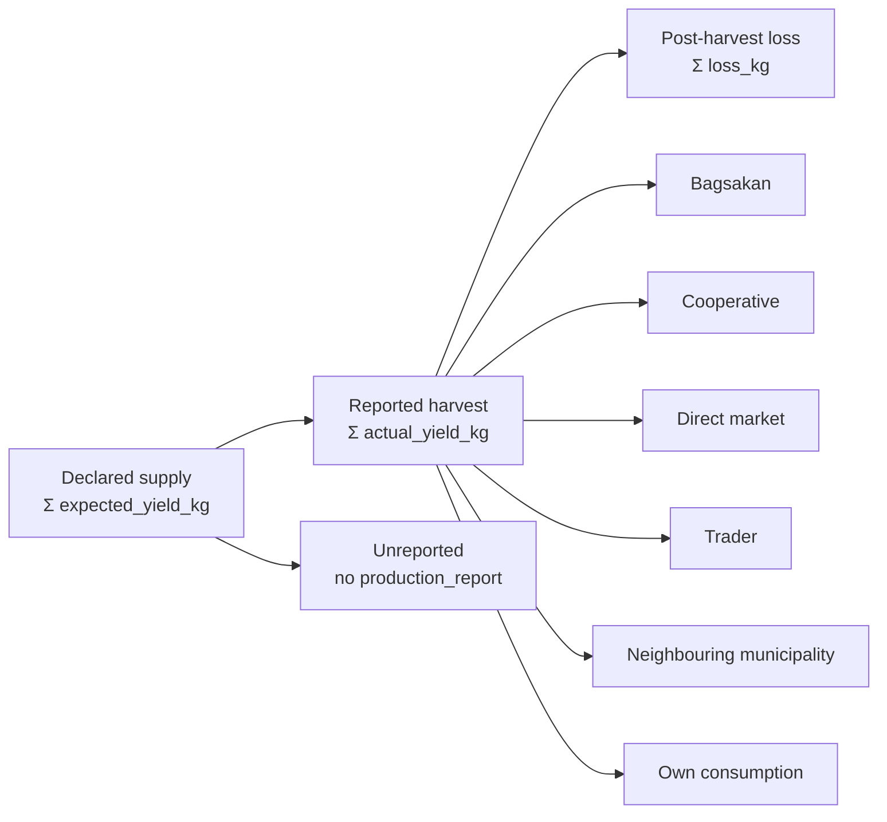

# Web Portal — Supply Chain Visualizations (MAO)

> **Scope.** This document specifies the *supply-chain* module of the MAO web
> portal only — the "**diin nagkadto ang supply?**" question. It is the build
> spec for adviser notes **1.6 / 2.7 / 2.11** ("need sang supply chain
> dashboard", "may map ang MAO sa dashboard kung diin damo ga tanom").
>
> For portal-wide concerns — stack, hosting, auth, role routing — see
> [`WEB_PORTAL_GUIDE.md`](WEB_PORTAL_GUIDE.md). **Note that guide is now partly
> stale:** its §4 and the "Validation queue" module describe the BAW → Technician
> → MAO approval chain, which was **removed** from the system (adviser note 6).
> `DeclarationStatus` is now only `active` / `harvested` / `cancelled`. Ignore
> those sections; this document supersedes its §5.3.

---

## 1. The question this dashboard answers

The municipality can already see **what was planted** — every declaration
carries crop, variety, area, barangay, and an expected harvest date. What it
cannot see is **where the harvest actually went**, and that gap is the whole
point of this module.

A farmer in Tubungan can sell to the bagsakan, to their cooperative, to a
travelling trader, or to a buyer from another municipality. The last two move
produce *out of the monitored chain*: the MAO's demand figures, price
monitoring, and oversupply warnings are all computed against volume it can see.
Every ton that leaves unobserved makes the Saturation Index less true.

So the dashboard has four jobs, in priority order:

1. **Quantify leakage** — how much of the harvest left the monitored chain, by
   crop, barangay, and month.
2. **Reconcile plan against reality** — declared supply vs. reported harvest vs.
   nothing reported at all.
3. **Show the price cost of leakage** — whether farmers selling outside the
   monitored channels got a better or worse price.
4. **Locate concentration** — which barangays are planting the same crop into
   the same window (note 7's map).

---

## 2. Data contract — what already exists

Everything below **ships today** in [`supabase/schema.sql`](../supabase/schema.sql)
and is populated by the mobile app. No mobile work is required for §4's
visualizations V1–V7.

### 2.1 `crop_declarations` — planned supply

| Column | Type | Notes |
|---|---|---|
| `id` | uuid | |
| `farmer_id`, `farm_id` | uuid | |
| `crop_id` | text | FK `crops(id)` |
| `variety` | text | |
| `area_ha` | numeric | |
| `planting_date` | date | transplant / direct-sowing |
| `seedling_sowing_date` | date | null when direct-seeded |
| `expected_harvest_date` | date | **buckets supply into a month** |
| `expected_yield_kg` | numeric | system-derived, not farmer-typed |
| `projected_price_per_kg` | numeric | |
| `barangay` | text | indexed — the geographic key |
| `status` | `declaration_status` | `active` \| `harvested` \| `cancelled` |
| `risk_at_declaration` | text | `low` \| `caution` \| `high` — the verdict shown before committing |

Indexes exist on `farmer_id`, `crop_id`, `barangay`, `status`.

### 2.2 `production_reports` — realized supply and disposition

| Column | Type | Notes |
|---|---|---|
| `declaration_id` | uuid | **`unique`** — see §3.1 |
| `actual_yield_kg` | numeric | |
| `actual_price_per_kg` | numeric | |
| `harvested_on` | date | |
| `loss_kg` | numeric | spoilage / rejects / calamity |
| `sold_to_channel` | `sales_channel` | **the leakage key**, indexed |
| `buyer_name` | text | nullable, free text |

`sales_channel` enum values (wire strings, from [`enums.dart:154`](../lib/models/enums.dart#L154)):

| Wire value | Label | Leaves municipality? |
|---|---|---|
| `bagsakan` | Bagsakan / Trading Post | no |
| `cooperative` | Cooperative Buy-back | no |
| `trader` | Trader / Consolidator | **yes** |
| `direct_market` | Direct to Market / Consumer | no |
| `neighbouring_municipality` | Buyer from Another Municipality | **yes** |
| `own_consumption` | Own Consumption / Not Sold | n/a — exclude from sold totals |
| `other` | Other | unknown |

The "leaves municipality" column is not a database property — it is
`SalesChannel.leavesMunicipality` in Dart. **Web SQL must define it identically**
or the two portals will report different leakage rates:

```sql
sold_to_channel in ('trader', 'neighbouring_municipality')
```

### 2.3 `demand_signals` — what cooperatives committed to absorb

`cooperative_id`, `crop_id`, `period_start`, `period_end`, `demand_tons`,
`buyer_type`, `price_per_kg`, `buyer_name`. This is the *denominator* of the
Saturation Index when cooperatives have declared demand; comparing it against
what actually flowed through `cooperative` / `bagsakan` channels is V5.

### 2.4 `market_channels` — standing buy-back capacity

`cooperative_id`, `name`, `type`, `capacity_tons`, `crop_ids[]`, `price_per_kg`.

### 2.5 `market_prices` — the price baseline

`crop_id`, `price_per_kg`, `recorded_on`, `market`. The comparison series for V6.

---

## 3. Known data limits — read before designing any chart

These are real constraints in the current schema. Designing a visualization that
ignores them produces a chart that looks authoritative and is wrong.

### 3.1 One production report per declaration — split sales cannot be represented

`production_reports` carries `create unique index prod_decl_uidx on
production_reports(declaration_id)`. A declaration therefore has **exactly one**
`sold_to_channel`. A farmer who sells 60 % to the cooperative and 40 % to a
trader has to pick one, and the whole tonnage is attributed to it.

**Consequence:** channel attribution is all-or-nothing. Every channel figure in
§4 is an approximation whose error is unbounded in principle.

**Do not silently paper over this.** Either:

- **(a)** Label every channel chart "attributed by primary buyer" and move on —
  acceptable for the thesis, zero migration cost; or
- **(b)** Normalize into a `production_sales` child table (see §6) — the correct
  model, and required if sir wants defensible leakage percentages.

Recommend (a) for the defence build, (b) if the leakage figure is going to be
quoted as a finding.

### 3.2 `sold_to_channel` defaults to `bagsakan`

Both the column default and the mobile form's initial dropdown value are
`bagsakan`. A farmer who never touches the field records `bagsakan`. **You cannot
distinguish "sold at the bagsakan" from "did not answer."** This biases leakage
*downward* — the true figure is at least as bad as what you compute.

Mitigation: chart `bagsakan` in a visually distinct (hatched / lighter) style and
footnote it. Or make the mobile field required with no default — a small change,
noted in §6.

### 3.3 A missing production report is data, not zero

A declaration whose `expected_harvest_date` has passed with **no**
`production_reports` row is *unreported*, which is a stronger form of leakage
than selling to a trader: the municipality does not know the harvest happened at
all. Every denominator in §4 must decide explicitly whether it includes these.

**Never let unreported declarations silently vanish into a percentage.** V2 shows
them as their own band.

### 3.4 `demand_baselines` in the database is annual only

The table is `demand_baselines(crop_id, annual_demand_tons, updated_at)` — one
row per crop. But the mobile app calibrates against
[`assets/data/demand_baselines.json`](../assets/data/demand_baselines.json),
which carries a **12-element `monthly_demand_tons` array** per crop.

Any monthly supply-vs-demand chart on the web needs monthly demand. Either read
the bundled JSON (fine for a Flutter Web build in this repo) or add the table in
§6. **Do not divide the annual figure by 12** — seasonality is the entire reason
the monthly array exists.

### 3.5 `buyer_name` is free text and nullable

Buyer concentration (V7) needs normalization — trim, casefold, and fuzzy-group
before aggregating, or "Mang Tonio", "mang tonio" and "M. Tonio" become three
buyers. Treat V7 as exploratory, not as a finding, unless a controlled buyer
list is introduced.

---

## 4. The visualizations

Ordered by value. V1–V3 are the core deliverable; V4–V7 are strong additions.

### V1 — Supply chain flow (Sankey)

**The headline chart.** Answers "diin nagkadto ang supply?" in one image.



- **Nodes:** declared → (reported harvest | unreported) → (loss | each channel).
- **Link width:** tons.
- **Colour:** monitored channels in the neutral/primary ramp; `trader` and
  `neighbouring_municipality` in the warning ramp; `unreported` in the danger
  ramp. The eye should land on leakage without reading a label.
- **Filters:** crop, barangay, harvest date range, cooperative.

Encode the *quantity* in link width only, and print the tonnage and percentage
on hover and in an adjacent table. A Sankey alone is not readable to three
significant figures, and the MAO will want the number.

### V2 — Disposition funnel (declared → harvested → monitored)

The same data as V1, as a stacked bar per crop — precise where V1 is intuitive.
This is the chart to put in the manuscript.

Bands per crop, as % of declared tons:

1. Sold through monitored channels (`bagsakan`, `cooperative`, `direct_market`)
2. Own consumption
3. **Leaked** (`trader`, `neighbouring_municipality`)
4. Post-harvest loss
5. **Unreported** (no production report past expected harvest)
6. Yield shortfall (declared − actual, where actual < declared)

Bands 3 and 5 are the finding. Sort crops descending by `3 + 5`.

### V3 — Leakage rate heatmap, crop × barangay

Reuses the exact grid component pattern already built for the cooperative portal
([`heatmap_grid.dart`](../lib/core/widgets/heatmap_grid.dart), used by
`_BarangayHeatmap` in
[`supply_projection_screen.dart:381`](../lib/features/cooperative/supply_projection_screen.dart#L381)).

- **Cell value:** leaked tons ÷ reported harvest tons, as a percentage.
- **Suppress low-n cells.** A barangay with one report showing "100 % leakage" is
  noise. Grey out cells with fewer than 3 contributing reports and say so in the
  legend.
- **Print the numeral in every cell.** Never encode the finding in hue alone —
  the existing `HeatmapGrid` already does this; keep it.

### V4 — Channel mix over time (stacked area, monthly)

Tons per `sold_to_channel` per month of `harvested_on`. Shows whether leakage is
seasonal — the hypothesis worth testing is that it spikes during congested
harvest peaks, when the bagsakan cannot absorb the volume and traders arrive.

Overlay the congested weeks from `HarvestSyncEngine.peaks` (§5) as vertical
bands. **If leakage tracks the congestion peaks, that is the single most
policy-relevant finding this dashboard can produce** — it turns "farmers sell to
traders" into "farmers sell to traders *because* everyone harvests at once",
which is a problem the staggering recommendations already address.

### V5 — Committed demand vs. actual absorption

Grouped bars per crop per period:

- **Committed** — Σ `demand_signals.demand_tons` covering the period.
- **Absorbed** — Σ tons where `sold_to_channel in ('cooperative','bagsakan')`.
- **Available** — Σ reported harvest.

Answers whether cooperative commitments were honoured, and it validates the
Saturation Index denominator against reality. If committed demand consistently
exceeds absorption, the oversupply warnings have been too optimistic.

### V6 — Price realization by channel

Volume-weighted mean `actual_price_per_kg` per channel per crop, against the
`market_prices` series for the same month.

```
premium(channel) = Σ(actual_price × actual_yield) / Σ(actual_yield)
                 − mean(market_prices.price_per_kg for that crop-month)
```

A negative premium on `trader` is the argument for intervention: it shows
leakage costs farmers money, not just monitoring coverage. Show it as a diverging
bar around zero.

Weight by volume, never a plain mean of prices — one 20 kg sale must not
outweigh a 3-ton one.

### V7 — Buyer concentration (exploratory)

Top buyers by tons, from normalized `buyer_name` (see §3.5). Reveals dependence
on a handful of consolidators. Label it exploratory.

### V8 — Planting concentration map (adviser note 7)

"May map ang MAO sa dashboard kung diin damo ga tanom."

The aggregation already exists and is portal-agnostic:
`SaturationEngine.supplyByBarangay(declarations)` →
`Map<barangay, Map<cropId, tons>>`
([`saturation_engine.dart:301`](../lib/core/logic/saturation_engine.dart#L301)),
exposed as `supplyByBarangayProvider`
([`data_providers.dart:313`](../lib/providers/data_providers.dart#L313)).

Two options:

- **Choropleth** (`flutter_map` + a Tubungan barangay GeoJSON). Reads as a map to
  a panel, but **requires barangay boundary polygons that the project does not
  currently have** — sourcing them from PhilGIS or the municipal planning office
  is a prerequisite, not a coding task.
- **Crop × barangay grid** — the existing `HeatmapGrid`, zero new dependencies,
  works offline, and already ships on the cooperative portal.

Recommend shipping the grid first and treating the choropleth as an upgrade
gated on obtaining the GeoJSON. A grid that renders beats a map that is blocked
on data.

---

## 5. Reuse the Dart engines — do not reimplement the math

The decision engines in [`lib/core/logic/`](../lib/core/logic) are pure Dart with
no Flutter or Supabase dependency, so a Flutter Web build runs them unchanged:

| Engine | Function | Use |
|---|---|---|
| `SaturationEngine` | `forAllCrops`, `monthlyMatrix`, `supplyByBarangay` | V8, supply context |
| `HarvestSyncEngine` | `peaks`, `suggestions`, `projectionForCrop` | V4 congestion overlay |
| `FinancialEngine` | `totalOf`, realized P&L | V6 context |

**If the web is built on a non-Flutter stack instead, the leakage predicate and
the saturation bands must be reimplemented to match exactly:**

```
leaked        := sold_to_channel IN ('trader','neighbouring_municipality')
saturation    := expected_supply_tons / demand_tons     (over the same window)
band          := index < 0.85 → low; 0.85..1.15 → moderate; > 1.15 → high
```

Two portals reporting different saturation bands for the same crop would be
indefensible at the defence. The thresholds are
`SaturationEngine.lowCeiling` / `highFloor`
([`saturation_engine.dart:164`](../lib/core/logic/saturation_engine.dart#L164)).

---

## 6. Backend work required

### 6.1 Base view — build every chart on this

One row per declaration, joining plan to outcome. Every visualization in §4
derives from it, which keeps the leakage definition in exactly one place.

```sql
create or replace view public.v_harvest_disposition as
select
  d.id                                as declaration_id,
  d.farmer_id,
  d.crop_id,
  d.barangay,
  d.status,
  d.area_ha,
  d.expected_harvest_date,
  d.expected_yield_kg / 1000.0        as declared_tons,
  p.id is not null                    as is_reported,
  coalesce(p.actual_yield_kg, 0) / 1000.0 as actual_tons,
  coalesce(p.loss_kg, 0)         / 1000.0 as loss_tons,
  p.sold_to_channel,
  p.actual_price_per_kg,
  p.buyer_name,
  p.harvested_on,
  date_trunc('month', p.harvested_on)::date as harvest_month,
  -- Keep this predicate identical to SalesChannel.leavesMunicipality.
  (p.sold_to_channel in ('trader', 'neighbouring_municipality')) as is_leaked,
  -- Past due with nothing filed: unmonitored, which is not the same as zero.
  (p.id is null
     and d.status <> 'cancelled'
     and d.expected_harvest_date < current_date)  as is_unreported
from public.crop_declarations d
left join public.production_reports p
       on p.declaration_id = d.id
where d.status <> 'cancelled';
```

### 6.2 Rollups

```sql
-- V3: leakage rate by barangay x crop, with an n for low-count suppression.
create or replace view public.v_leakage_by_barangay as
select
  barangay,
  crop_id,
  count(*) filter (where is_reported)               as reports_n,
  sum(actual_tons)                                  as reported_tons,
  sum(actual_tons) filter (where is_leaked)         as leaked_tons,
  case when sum(actual_tons) > 0
       then sum(actual_tons) filter (where is_leaked) / sum(actual_tons)
       else null end                                as leakage_rate,
  count(*) filter (where is_unreported)             as unreported_n,
  sum(declared_tons) filter (where is_unreported)   as unreported_declared_tons
from public.v_harvest_disposition
group by barangay, crop_id;

-- V4: channel mix by month.
create or replace view public.v_channel_mix_monthly as
select harvest_month, crop_id, sold_to_channel,
       sum(actual_tons) as tons, count(*) as reports_n
from public.v_harvest_disposition
where is_reported
group by harvest_month, crop_id, sold_to_channel;

-- V6: volume-weighted price realisation per channel.
create or replace view public.v_price_realisation as
select crop_id, sold_to_channel, harvest_month,
       sum(actual_price_per_kg * actual_tons) / nullif(sum(actual_tons), 0)
         as weighted_price_per_kg,
       sum(actual_tons) as tons
from public.v_harvest_disposition
where is_reported and actual_tons > 0
group by crop_id, sold_to_channel, harvest_month;
```

### 6.3 Schema additions

| # | Change | Blocks | Priority |
|---|---|---|---|
| 1 | `demand_baselines_monthly(crop_id, month, demand_tons, source)` — or read the bundled JSON | any monthly supply-vs-demand chart (§3.4) | **required** |
| 2 | `production_sales(id, production_report_id, channel, tons, price_per_kg, buyer_name)` + drop the unique index on `declaration_id` | defensible split-sale attribution (§3.1) | recommended |
| 3 | Make `sold_to_channel` non-defaulting on the mobile form; add an explicit "Not sure" option | removes the `bagsakan` bias (§3.2) | recommended |
| 4 | Tubungan barangay boundary GeoJSON | V8 choropleth | optional |

Items 2 and 3 are **mobile changes**, small but real: `production_report_sheet.dart`
and the `ProductionReport` model. They are the only mobile work this dashboard
needs, and V1–V7 all ship without them.

---

## 7. Suggested build order

| Step | Deliverable |
|---|---|
| 1 | §6.1 base view + §6.2 rollups; verify against `seed.sql` data |
| 2 | **V2** disposition funnel — highest information density, least chart machinery |
| 3 | **V3** leakage heatmap — reuses the existing `HeatmapGrid` |
| 4 | **V1** Sankey — the presentation centrepiece, once the numbers behind it are trusted |
| 5 | **V8** planting concentration grid (note 7); choropleth if GeoJSON arrives |
| 6 | **V4** + **V5** — seasonality and the demand reconciliation |
| 7 | **V6** price realisation; **V7** buyer concentration if buyer data proves usable |

Build steps 2–3 before step 4. A Sankey is the chart everyone wants first and the
one most likely to mislead while the underlying attribution is still unverified.

---

## 8. Honest framing for the defence

Two things this dashboard **cannot** currently claim, and should not be presented
as claiming:

1. **Exact leakage percentages**, until §6.3 item 2 lands. One channel per
   declaration means the figure is a primary-buyer attribution, not a
   measurement.
2. **That `bagsakan` volume is real bagsakan volume**, until item 3 lands. It
   includes every farmer who left the default alone.

Both are defensible if stated. Neither is defensible if the chart is presented
without them. State the limitation in the figure caption, not only in the text —
a chart travels separately from the paragraph that qualifies it.
